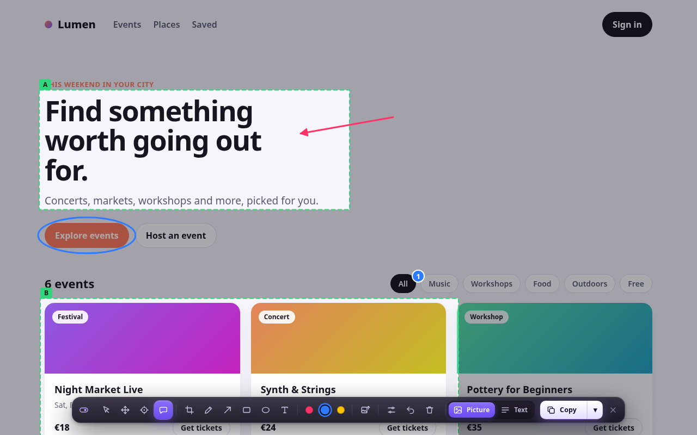
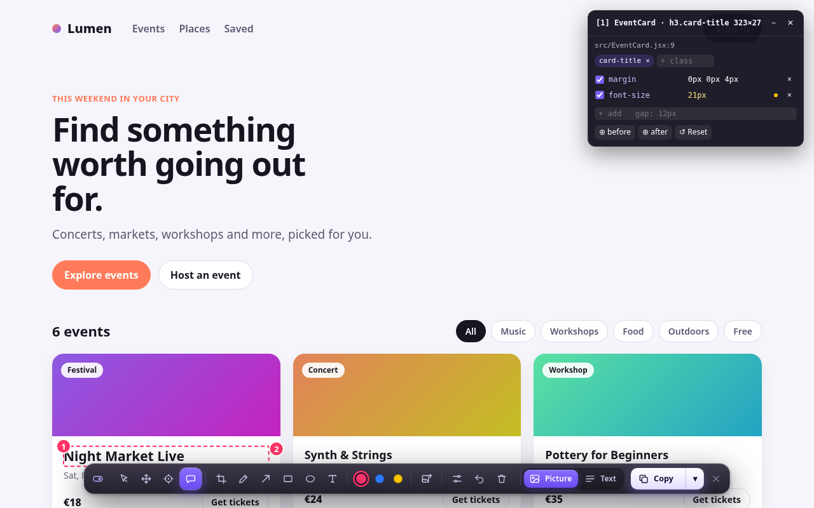
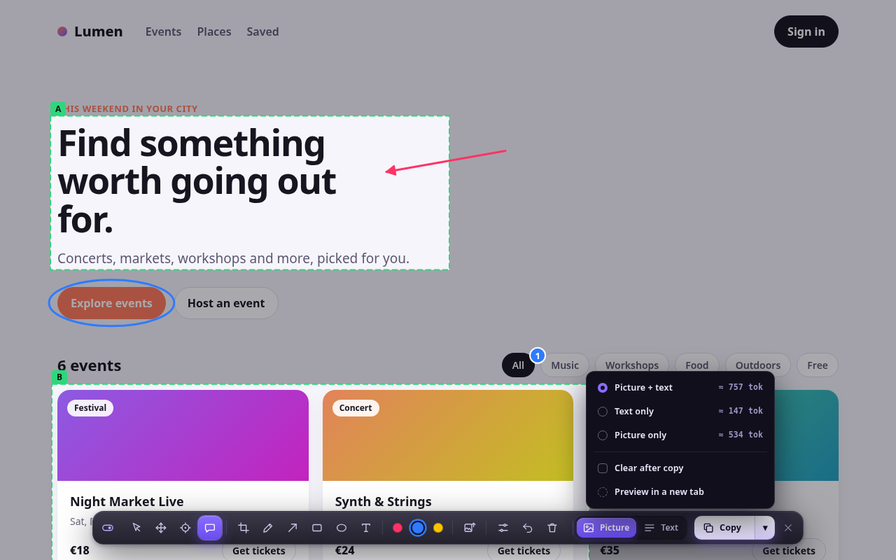

<p align="center"></p>

<h1 align="center">Pointer</h1>

<p align="center"><strong>Show your coding agent exactly what to change.</strong><br>
Point at your page, click Copy, paste into Claude Code, Cursor or any AI chat.<br>
Your agent gets one picture and the source <strong>file:line</strong> of everything you marked.</p>

<p align="center">
  <a href="https://github.com/021is/pointer/releases/latest">Download</a> ·
  <a href="https://www.youtube.com/watch?v=mjzsXVzJk3o">Watch the demo</a> ·
  <a href="#start-in-four-steps">Start</a> ·
  <a href="#nothing-happens">Help</a> ·
  <a href="https://021.is/plugins/pointer">021.is/plugins/pointer</a>
</p>

https://github.com/user-attachments/assets/5082e59f-6cd5-455d-ab65-c671afe3170d

<p align="center"><sub>The 40-second demo, with sound. Doesn't play? <a href="https://www.youtube.com/watch?v=mjzsXVzJk3o">Watch it on YouTube</a>.</sub></p>

<p align="center"></p>

No more "the thing on the left, a bit bigger, no, the other one". Comment, pick, crop or draw,
then Copy and paste. Your agent opens the right file without searching:

```
Pointer · http://localhost:3000/events · viewport 1440×900 · react
Task: the user marked these elements on this page. For each [n] (its number is on the picture): open the file at that line …
[1] pick · EventCard "Night Market Live" · src/features/events/EventCard.tsx:142 (in EventList.tsx:32)
   changed: font-size 14px → 18px
[2] comment · Button "Filters" · src/components/ui/button.tsx:70 (in FiltersButton.tsx:26)
   note: remove this
```

Free and open source (MIT), by [021](https://021.is/plugins/pointer). Made by Edvard Grei.

## Install

The Chrome Web Store listing is on its way. Until then, install it yourself in about a minute.

**Download (no tools needed)**

1. Download `pointer-<version>.zip` from the [latest release](https://github.com/021is/pointer/releases/latest)
   and unzip it.
2. Move the unzipped folder somewhere it can stay, for example Documents. Chrome runs Pointer from
   that folder, so if you delete it, Pointer stops working.
3. Type `chrome://extensions` in the address bar. Turn on **Developer mode** (top right).
4. Click **Load unpacked** and choose the unzipped folder.
5. Click the puzzle piece next to the address bar and pin Pointer.

Done: Pointer's welcome page opens by itself. To open it again later, right-click Pointer's icon
and choose **Options**.

**From source** (needs [Node.js](https://nodejs.org) 22 or newer, and git)

```sh
git clone https://github.com/021is/pointer.git
cd pointer && npm ci && npm run build
```

Then do steps 3 to 5 above, and choose the `dist` folder inside `pointer`. After a later
`git pull && npm run build`, press ↻ on Pointer's card in `chrome://extensions` and reload your page.

## Start in four steps

1. **Open your app.** Open the page you are building in Chrome. In development mode
   (`npm run dev`) your agent also gets the file and line.
2. **Turn Pointer on.** Press **Alt+P** (on a Mac **⌃⇧P**, Control+Shift+P), or click Pointer's
   icon. A dark bar appears at the bottom of the page: it is on. Any other key: set your own in
   `chrome://extensions/shortcuts`.
3. **Show what you mean.** Click where something should change, type what you want, press Enter.
   A numbered pin marks it. Add as many as you like.
4. **Copy and paste.** Click **Copy**, then paste into your agent's chat: Ctrl+V in Claude Code's
   terminal (on a Mac too), ⌘V or Ctrl+V in Cursor and VS Code.

**Is it on?** A dark bar sits at the bottom centre of the page, with Comment selected, and the
mouse is a crosshair. **To turn it off,** press the shortcut again, click the icon again, press Esc
twice, or click the ✕ at the right end of the bar.

## Nothing happens?

| What you see | What to do |
|---|---|
| A red **!** on Pointer's icon | Chrome lets no extension run on that page (`chrome://` pages, the Web Store, the PDF viewer). Use it on your app's tab. |
| The shortcut does nothing | Hold the mouse over Pointer's icon: it names the key Chrome gave Pointer, or says none is set (Chrome gives the key only when nothing else uses it; Pointer then opens its welcome page with a **Set a shortcut** button). Set your own key in `chrome://extensions/shortcuts`, or click the icon. |
| No file and line in the copy | Your app is not running in development mode, or its framework gives no source information (see [below](#where-the-file-and-line-come-from)). Your agent still gets each element's text and selector, which is enough to find it. |
| It doesn't run on a `file://` page | In `chrome://extensions`, open Pointer's **Details** and turn on **Allow access to file URLs**. |
| Paste gives only the picture | That's expected in Claude Code: its chat keeps only the image. The picture has the file:line lines printed under it, so nothing is lost. |

Still stuck? [Open an issue](https://github.com/021is/pointer/issues) and say what you pressed and what you saw.

## Tools and keys

<p align="center"></p>

| Key | Tool | What it does |
|---|---|---|
| C | **Comment** (the default) | Click anywhere, type, Enter. Click a number to edit it, drag it to move it. |
| P | **Pick** | Edit an element's CSS live: click it and its style box opens. ↑ parent, ↓ child, ← → siblings, Enter takes it. |
| Q | **Idea** | Click what could be better, add your thought if you like. Your agent answers as a UI/UX expert and design critic: what is wrong and why, 2–3 fixes, and it asks before building. |
| X | **Crop** | Click a component, or drag a frame. Several frames (A, B…) make one picture. Draw and comment inside them. |
| G | **Gap** | Drag from one element to another (or to its container): it snaps to their edges and measures the space, \|← 24px →\|. Its note: smaller, bigger or the gap you want. |
| D A B E T | **Draw** | One button on the bar holds pen, arrow, box, ellipse, gap and text: it shows the last one used, ▾ (or a second press) opens the others. Pen, arrow, box, ellipse, text. Shift: straight line, 45° arrow, square, circle. 1 2 3: red, blue, yellow. Double-click a box or an ellipse to type on it: "[5] box: make this one card". |
| M | **Move** | Drag any mark or pasted image. Delete removes the one under the mouse. |
|   | **Icons** | The icon button next to the drawing tools: search [Lucide](https://lucide.dev) by name or tag, click one to add it where your mouse was, or drag it onto the page. Drag it to move it, its corner resizes it, Delete removes it. Your agent reads "[6] icon: lucide calendar-heart on EventCard (EventCard.tsx:27)". |
| V | **Page** | Use the page as usual. Clicks go through and the marks stay. |
| ⌘V / Ctrl+V | **Paste an image** | Puts a screenshot or mockup on the page at the mouse (or use the bar's image button). Drag it, resize it from its corner (Shift: free), `[` `]` make it see-through. It stays until the page reloads. |
| S | **Styles** | The style box of the last pick, and away again. |
| I | **Picture \| Text** | The switch next to Copy: what Copy gives. Text hides the tools that only make sense in a picture. |
| ⌘C / Ctrl+C | **Copy** | Copies for your agent. The ▾ next to Copy shows each choice's cost and opens a preview. |
| ⌘Z / Ctrl+Z | **Undo** | Takes back the last mark, or the last Clear everything. |
| ⌘⇧Z / Ctrl+Shift+Z or Ctrl+Y | **Redo** | Puts back what Undo took, style edits too. A new mark after an Undo starts afresh. |
| ⇧⌫ / Shift+Delete | **Clear everything** | Clears all marks and style edits. **Undo** in the message (or ⌘Z) brings them back. |
| Esc | | Back to the page tool. Press it again to close Pointer. |

### The style box

Pick an element and its style box opens at the top right. It floats, so the page's width never
changes. It lists the CSS that reaches the element and its classes.

- Click a value to change it. ↑/↓ nudge the first number (Shift ×10, Alt ×0.1), Enter applies it.
- The checkbox turns a property off, × removes it, and `+ add` takes a new one, such as `gap: 12px`.
- A class chip's × removes the class, and `+ class` adds one. A class with no rule on the page
  is marked "not built yet", as with a Tailwind class the code never used.
- ⊕ before / after puts a dashed placeholder next to the element; type its label right away.
- ↺ Reset puts the element back. − collapses the box, and ✕ or S closes it.

Edits are live, on that element only, and Copy adds them under `changed:`. Undoing a pick undoes
its edits, and so does reloading the page.

```
   changed: font-size 96px → 72px
            removed class: font-urbanist
            inserted after it: placeholder "Map" (1088×48)
```

### What Copy gives

<p align="center"></p>

- **Picture + text** (the default): the picture, with a compact form of the lines printed in a dark
  strip under it, plus the full text. Claude Code keeps only the image of a paste, so the picture
  alone still carries each mark's component, file:line, changes and note.
- **Text only:** just the lines, about 30 to 40 tokens a mark. That's about 3× cheaper than a
  picture, when the words say enough.
- **Picture only:** the picture with no strip and no text.

Every copy opens with one `Task:` line, so any agent knows what the numbers, files and changes
mean and what to do with them. The picture is cropped to your marks and stays within what Claude
reads at full size (≤ 1568 px a side, ≤ 1.15 MP). When it would not fit, the frames shrink, never
the text.

## Where the file and line come from

Only a **development build** has them:

| Framework | What your agent gets |
|---|---|
| React 19 (Next.js with Turbopack or webpack, Vite), server components too | file:line, and the components it sits in |
| React 18 and older | file:line |
| Vue 2 and 3 | the component's file |
| Svelte 4 and 5 | file:line |
| Angular | the component's name |
| Any other page, or a production build | the element's text, selector, classes and styles, and why there is no file |

## Privacy

Pointer asks for `activeTab`, `scripting` and `storage` only. It has no access to any site until
you press its icon or shortcut on that tab, and only until you turn it off. It sends nothing: what
you mark goes to your clipboard, and you decide where to paste it. So that a reload does not wipe
your marks, it keeps them in Chrome's session memory for that tab and page only
(`chrome.storage.session`: never written to disk, never synced, gone when the tab or Chrome
closes, and forgotten when you clear everything or close Pointer). The only reads
beyond the page are its own dev server's source maps (same origin), to find the file and line. The
picture is drawn on a canvas, so it carries no metadata.
Full policy: [021.is/plugins/pointer/privacy](https://021.is/plugins/pointer/privacy)

## Contribute

Issues and pull requests are welcome.

- `npm run watch` rebuilds `dist/` on save.
- `npm run check` is the whole gate (Biome, tsc, the 300-line rule, vitest, the build). CI runs it
  too, plus gitleaks.
- `demo/` is a small Vite + React app to try Pointer on, with real file:line:
  `cd demo && npm ci && npm run dev`.
- How the code is laid out, and the few rules it keeps: [AGENTS.md](AGENTS.md).

## Licence

MIT © Edvard Grei. Made at [021](https://021.is).
